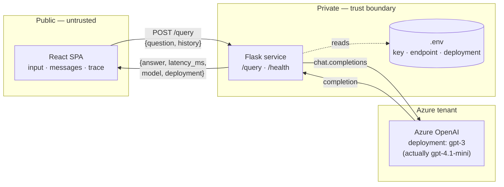
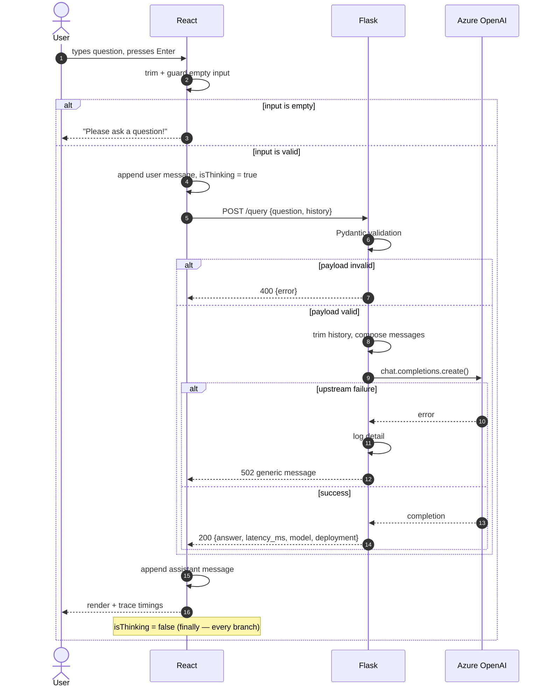
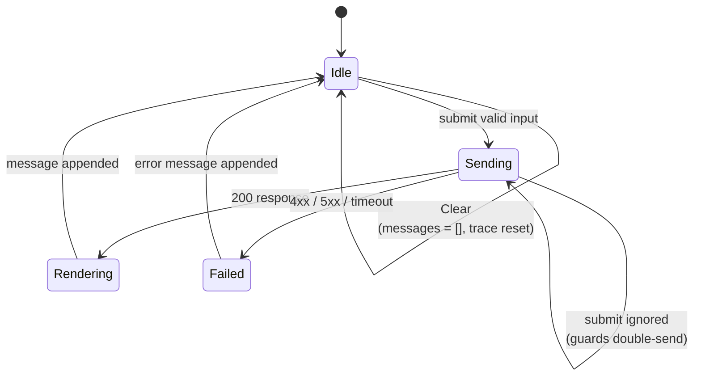
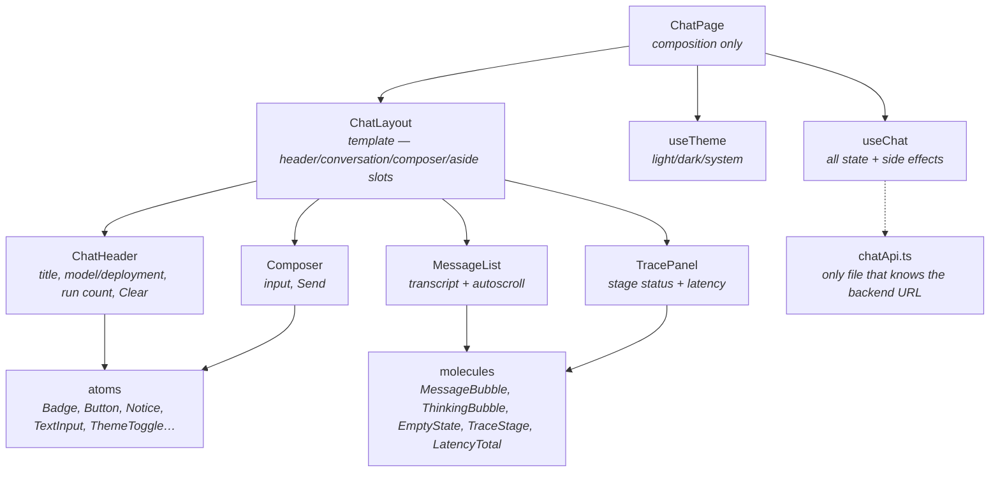
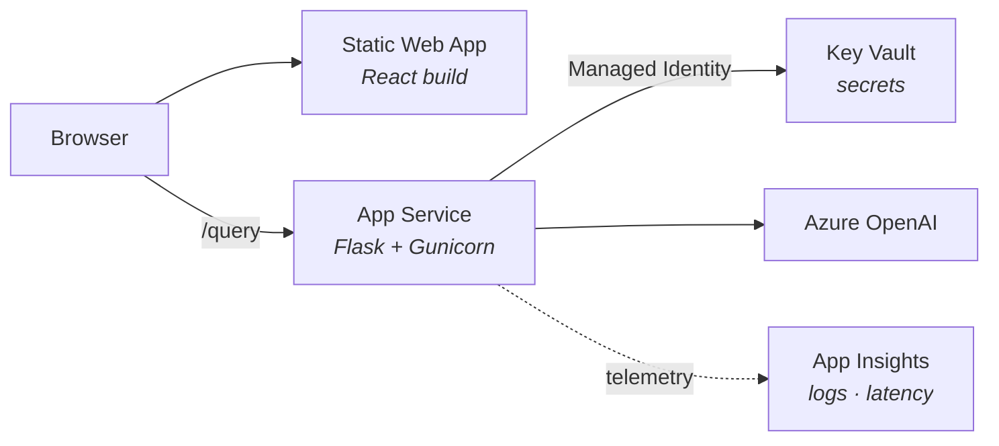
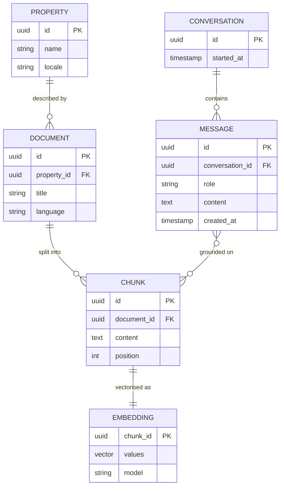

# Diagrams & Architecture Decisions

Companion to `ARCHITECTURE.md`. Mermaid blocks render natively on GitHub.

---

## 0. Which diagrams this system actually needs

Choosing what *not* to draw is part of the design work. A diagram that describes a system other than the one built is worse than no diagram.

| Diagram | Included | Reasoning |
|---|:---:|---|
| Container / context | ✅ | Three tiers and one trust boundary — the core of the design |
| Sequence (request lifecycle) | ✅ | The assignment is explicitly about data flow |
| UI state machine | ✅ | The assignment is explicitly about control flow |
| Component tree (frontend) | ✅ | Shows where state lives and why |
| Deployment (Azure) | ✅ | The role is cloud-native; shows how this runs beyond localhost |
| **ERD / data model** | ❌ | **There is no database.** The server is stateless and history lives in client memory. An ERD here would describe entities that do not exist. |
| Class diagram | ❌ | Four modules, no inheritance hierarchy. The file tree carries the same information. |
| Infrastructure network diagram | ❌ | Out of scope for a demo; belongs to a real deployment review. |

**When the ERD becomes necessary:** the moment conversations persist. Phase 2 (§5) sketches that data model, because grounding on documents introduces real entities — and at that point the diagram earns its place.

---

## 1. Container view

The single most important line in this diagram is the one that is **absent**: there is no arrow from the browser to Azure. That is the whole reason the middle tier exists.

---

## 2. Sequence — one request, end to end

---

## 3. UI state machine

The four states the interface can occupy, and the only transitions between them. Anything not drawn here is a bug.

`Sending → Sending` is deliberate: while a request is in flight, further submits are dropped rather than queued. Two concurrent calls would return out of order and corrupt the transcript.

---

## 4. Frontend component tree

The frontend is 100% TypeScript, organised by Atomic Design (ADR-009) rather than the flat four-component sketch this diagram originally showed. There is no `App.jsx` — that name belongs only to the unused prototype at the repo root.

State is held in one place — the `useChat` hook, not a component — and passed down as props. Every organism, molecule and atom below it is pure and presentational. With this many components a store would be ceremony for the same reason it was in the original four-component sketch; the difference is the tree is now deep enough that centralising state in a hook (rather than a top component) is what keeps prop-drilling manageable.

`chatApi.ts` is isolated so the backend URL appears exactly once in the codebase, mirroring `azure_client.py` on the server. There is no mock left to swap — the prototype's `mockQuery` was replaced with a real `fetch` early in the build.

---

## 5. Deployment — target architecture (not yet built)

**Nothing below this line is deployed.** The app runs locally (`flask run` and `vite dev`) against a real Azure OpenAI resource; Static Web Apps, App Service, Key Vault and App Insights are the answer to "how would this run on Azure", not a description of anything running today.

The step worth calling out: with **Managed Identity**, App Service authenticates to Key Vault as itself, so no credential is stored in the application at all. `.env` is the local-development equivalent, not the production answer.

---

## 6. Phase 2 — where a data model finally appears

Grounding answers on the Casa Brunelli documents introduces persistence, and with it, entities worth drawing:

The `MESSAGE ↔ CHUNK` relation is what makes an answer auditable: for any reply, you can show which passages produced it. In a property-booking context, being able to prove where a claim came from is the difference between a useful assistant and a liability.

---

## 7. Architecture Decision Records

Short records, one decision each. Format: context, decision, consequences, alternatives rejected.

### ADR-001 — Flask as the web framework

**Context.** The brief allows Flask or FastAPI. Sherpa builds its web services in Flask.
**Decision.** Flask.
**Consequences.** No automatic schema validation or generated docs; both are added deliberately (ADR-004). The submission is readable by the team that would maintain it.
**Rejected.** *FastAPI* — better defaults for this exact shape, but a mismatch with the team's stack. *Django* — its value is the ORM, migrations, and admin; this service has no use for any of them.

### ADR-002 — The backend is a trust boundary, not a proxy

**Context.** The browser could call Azure OpenAI directly.
**Decision.** All model calls route through Flask.
**Consequences.** One extra hop of latency. The API key never reaches the client. The system prompt, context assembly, and the history forwarded upstream become server-side concerns that can change without a frontend release. (There is no rate limiting in this system — see the known-gaps note in `ARCHITECTURE.md` §11. This ADR is about the key and the server-side concerns above, not about traffic control.)
**Rejected.** *Direct browser→Azure* — the key would be readable in devtools by any visitor.

### ADR-003 — Stateless server; the client carries the history

**Context.** The model has no memory between calls; context must be supplied each time.
**Decision.** The client sends `history` with every request; the server trims it before forwarding.
**Consequences.** No session store, no sticky sessions, horizontally scalable by default. A page refresh loses the conversation.
**Rejected.** *Server-side session store* — correct once conversations must persist, but it introduces infrastructure this demo does not need.

### ADR-004 — Pydantic v2 as a standalone dependency

**Context.** Flask has no built-in request validation.
**Decision.** Validate the payload at the boundary with a Pydantic model.
**Consequences.** The API contract lives in one file, in code rather than prose. Validation is an explicit, reviewable decision rather than framework magic.
**Rejected.** *Manual `if` checks* — they drift out of sync with the contract. *Marshmallow* — equivalent, but Pydantic is the current default in the Azure OpenAI Python ecosystem.

### ADR-005 — No database

**Context.** The assignment scope is question in, answer out.
**Decision.** No persistence layer.
**Consequences.** Nothing to migrate, back up, or secure at rest. No analytics on past conversations.
**Revisit when.** Conversations must survive a refresh, or answers must be grounded on stored documents (Phase 2, §6).

### ADR-006 — Whole responses, not streaming

**Context.** The deployment supports token streaming.
**Decision.** Return the completed response.
**Consequences.** Simpler contract and error handling; perceived latency is worse on long answers. The `Thinking…` state and visible timings mitigate it.
**Revisit when.** Answers routinely exceed a few sentences — streaming is the first improvement I would make.

### ADR-007 — Surfacing the request trace in the interface

**Context.** The brief asks for evidence of thinking about data and control flow.
**Decision.** Render each stage of the pipeline with live status and real timings.
**Consequences.** A small amount of extra UI state. The flow becomes observable rather than merely documented, and slow responses can be attributed to network or model without opening devtools.
**Rejected.** *Console logging only* — invisible to anyone reviewing the running app.

### ADR-008 — Report the model Azure returns, not the deployment name

**Context.** The deployment is named `gpt-3` and was described early on as `gpt-35-turbo`. Azure's own response reports `gpt-4.1-mini-2025-04-14`.
**Decision.** `AzureClient.complete()` returns a `Completion` carrying both the answer and `response.model`. The API returns `model` (what ran) alongside `deployment` (the configured label), and the UI shows the former.
**Consequences.** The interface cannot drift from reality as deployments are repointed. A deployment name is an arbitrary label, not a fact about the model behind it.
**Rejected.** *Echoing the configured deployment name* — the original behaviour, which reported `gpt-3` and was simply wrong.

### ADR-009 — Atomic Design in strict TypeScript on the frontend

**Context.** The prototype was a single 485-line component with inline styles.
**Decision.** Decompose into quarks → atoms → molecules → organisms → templates → pages, with imports flowing only upward, in strict TypeScript. All state lives in `useChat`; components below it are pure.
**Consequences.** Types make the level boundaries enforceable rather than a folder convention, and `types/chat.ts` mirrors `schemas.py` so one contract is checked at both ends of the wire. More files to navigate. Vite does not typecheck, so `npm run typecheck` is a separate step.
**Rejected.** *Keeping one component* — faster to ship, but state, layout, styling and transport would stay entangled and untestable.

### ADR-010 — Theming through CSS custom properties

**Context.** The interface needs a light and a dark theme.
**Decision.** Token values live as CSS custom properties in `index.css`; the quarks export `var(--ca-*)` references.
**Consequences.** A theme swap changes values underneath every atom with no component aware that a theme exists, and the system preference is honoured without JavaScript. Token values are no longer visible to TypeScript, so a typo in a variable name fails silently at runtime rather than at compile time.
**Rejected.** *Branching on a theme object in JS* — every styled component would need the current theme threaded through it.

*These three ADRs, and the full text of ADR-001 through ADR-007, live in the code repository's `docs/ADR.md` — that file is the source of truth; this section is a summary kept consistent with it.*

---

## 8. Questions I expect, and the short answers

| Question | Answer |
|---|---|
| Why Flask and not FastAPI? | ADR-001 — team fit first, and the two things FastAPI gives free are added on purpose. |
| Where does the API key live? | Server-side `.env` locally; Key Vault via Managed Identity in Azure. Never in the client. |
| What happens if Azure is down? | Caught, logged with full detail, client receives a generic 502 message. UI stays usable. |
| Why send history from the client? | The model is stateless (ADR-003). Keeps the server horizontally scalable. |
| How do you stop token costs running away? | Input capped at 1000 chars, history trimmed to 10 turns server-side, a 30s timeout on the Azure call. No rate limiting exists yet — an honest gap, not a hidden one. |
| What model is actually running? | The deployment is labelled `gpt-3`; Azure reports `gpt-4.1-mini-2025-04-14`. The API returns both (ADR-008) so the UI never has to trust the label. |
| Why no database? | ADR-005 — nothing to persist in this scope. Phase 2 is where the data model starts. |
| How would you test it? | `azure_client` is isolated, so `/query` can be tested against a stub. Built: `check_schemas.py`, `check_azure_client.py`, `check_app.py` — ~48 hand-rolled assertions covering validation, message assembly, history trimming, every endpoint path, and CORS. Not wired into CI. |
| What would you build next? | Streaming, then grounding on real documents (Phase 2). |
